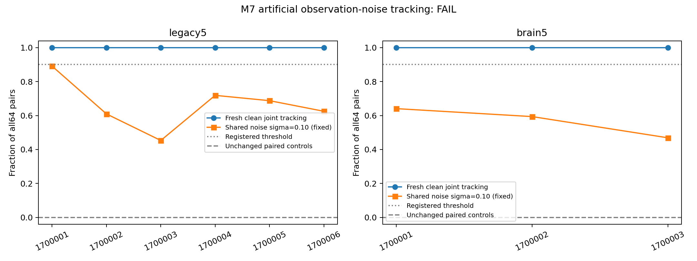

# M7: frozen-readout tracking under artificial observation noise — results

Date: 2026-10-12. **Registered primary FAIL; paired secondary FAIL.**
All nine cases and independent verification are complete. Verification PASS
means the negative scientific result was reproduced, not that the hypothesis
passed. No dose, seed, threshold, model, scaler or decoder was changed after
outcomes. No new learned parameters; no P3 work.
[Protocol](counterfactual-noise-protocol.md),
[prior-scope audit](counterfactual-noise-prior-audit.md),
[config](../configs/counterfactual_noise.json).

## 1. What was asked?

Does M6-style lag2 historical-value tracking survive one predefined artificial
observation-noise condition with the M5 graph, encoder, dynamics, scaler and
readout frozen? This is a fresh iid input intervention, separate from previous
pi autonomous-recall noise studies and their preserved negative endpoints.

Baseline main is `191e8edbcb7b90e066c85bfead24f00d02d04c6e`, including the owner's
October 9 programme. Protocol/config were committed before outcomes as
`2d07a9d303bd700ab69fa29797f8d6a712624d08`. Main and independent verifier source
is `cfb05b0431a432271a8a93fb84e99e9df6aca168`.
The new namespace is `results/counterfactual_noise_v1/`.

Use circuit701 legacy5 primary and brain5 secondary, original signed incoming-L1
gain0.9 weights, drive0.6, direct carry0, prior-state synaptic drive and
mbon_after_kc. Same512 KC pool,51 KC per K10 symbol at amplitude0.5 and48 MBON
observations. The OLD M5 ridge lag2 head has490 affine parameters, alpha1,
4000 old iid training rows and the exact archived mean/floored scale.
Official new predictions always use those bytes. **New trained parameters:0.**

Six blocks1700001–1700006 retain parent heads1500001–1500006 and mappings
1510001–1510006. Fresh independent iid streams1710001–1710006, noise seeds
1720001–1720006, reset zero, warmup200, test2000. Whole uses the firstthree
paired counterparts, not three additional independent streams. At each of64
fixed anchors a, replace only symbol s by r=(s+1)%10. Replay a,a+1,a+2 from
the same full pre-state and read lag2 at a+2; prefix and future inputs match.
All64 count, including erroneous original predictions.

Fix sigma0.10 in the OLD decoder's standardized48-coordinate space:
`epsilon=0.10*frozen_M5_scale*Z`. PCG64 draws in ascending observed root-ID
order are restored to archived head order. Each original/replacement and both
instantaneous reference worlds share the exact same draw; paired graph
counterparts share standardized draws. Noise is added only to64 endpoint
observations. No clipping, recalibration or state/feedback write-back.
There is no noisy full-stream experiment or additional dose.

Primary is `count(pred_original==s AND pred_replacement==r)/64`.
Require exact `10*joint_correct>=9*64` in EVERY six partial blocks: minimum58/64.
Secondary applies the same rule separately to all three whole counterparts.
There is no clean-success filter or performance eligibility gate.

## 2. What was confirmed?

Independent replay confirms the recorded negative outcome and frozen provenance.
The fresh clean comparator tracks every pair; at the registered noisy condition
joint tracking falls in every block. The single-arm values are descriptive,
not alternative success criteria.

| Block | Partial clean joint | Partial noisy original / replacement / joint | Whole clean joint | Whole noisy original / replacement / joint |
| --- | ---: | ---: | ---: | ---: |
| 1700001 | 64/64 | 60 / 61 / 57 of64 | 64/64 | 50 / 53 / 41 of64 |
| 1700002 | 64/64 | 47 / 48 / 39 of64 | 64/64 | 50 / 46 / 38 of64 |
| 1700003 | 64/64 | 36 / 39 / 29 of64 | 64/64 | 43 / 39 / 30 of64 |
| 1700004 | 64/64 | 52 / 54 / 46 of64 | — | — |
| 1700005 | 64/64 | 53 / 48 / 44 of64 | — | — |
| 1700006 | 64/64 | 49 / 50 / 40 of64 | — | — |
| Total within cohort | 384/384 | 297 / 300 / **255 of384** | 192/192 | 143 / 138 / **109 of192** |

Every noisy block fails the integer gate. In particular57/64=89.0625% fails;
rounding or numeric validation tolerances do not turn it into58/64.
[Raw trials](../results/counterfactual_noise_v1/main/raw-trials.csv),
[block values](../results/counterfactual_noise_v1/main/block-scores.csv),
[official summary](../results/counterfactual_noise_v1/main/summary.json).

| Descriptive quantity | Partial, six computational blocks | Whole, firstthree paired counterparts |
| --- | ---: | ---: |
| Noisy joint mean | 66.40625% | 56.77083% |
| Noisy joint median | 65.625% | 59.375% |
| Sample SD across blocks | 14.41401pp | 8.88475pp |
| Bootstrap interval for block mean | 55.98958–77.08333% | 46.875–64.0625% |
| Original single-arm mean | 77.34375% | 74.47917% |
| Replacement single-arm mean | 78.125% | 71.875% |
| Clean-minus-noisy joint mean | 33.59375pp | 43.22917pp |
| Original errors / replacement errors / errors in both worlds | 87 / 84 / 42 | 49 / 54 / 20 |
| Pairs with at least one error | 129/384 | 83/192 |

Intervals use the fixed10000 block-resampling draws, seed1730001. Anchors
share streams/heads and are not independent animal replicates. Neither small
cohort is a biological statistical population; do not pool the paired cohorts.



The horizontal axis is fixed computational block, not dose or temporal lag.
The same fresh clean counterpart is descriptive; sealed M6 was not rescored.
Clean full-stream lag0 and lag2 sanity are100% in both cohorts. Those streams
remain unnoised and are not part of the noisy primary gate.

Frequency/current-only predictors are unchanged across each world pair,
and instantaneous reference final states plus their shared noisy observations,
scores and predictions are exactly equal. All have joint0 because s!=r.
This is a mathematical paired-control property, not a10% joint-chance estimate;
uniform10% applies only to a single-arm symbol guess. The instantaneous frozen
head is off its training distribution, so its marginal accuracy has no gate.

Every affine check agrees: noisy score equals clean score plus0.10*Z@head;
replacement-minus-original score vectors retain the clean difference. Shared
additive noise cancels that difference but can still move either world across
other class boundaries, producing the measured classification errors.
Noisy/clean scores, observations, predictions and exact draws are archived
per case in `noisy/*/noise.npz` and `clean/*/case.npz`.

Raw noise energies and floor counts are in the block table. Partial scale
floor count is0 in all six; whole counts are3,3,4. Noise still enters those
floor-bound coordinates with raw amplitude1e-6. Standardized energy is paired
by root ID, while raw energy and head geometry differ between graph levels.
This is not matched physical per-neuron training SD or physiological noise,
and it does not test whole-brain superiority.

## 3. What failed?

The registered robustness hypothesis **failed** at the sole sigma0.10
condition, in primary and secondary. Clean100% and noisy66.41%/56.77% do not
justify reporting successful robustness merely because some pairs remain
correct or single-arm values exceed10%. No smaller dose, extra seed/draw,
alternative endpoint, adaptation or retraining was attempted.

No neural execution, safeguard or independent verification failed technically.
The scientific FAIL is a completed valid result. The FIRST final artifact audit
stopped at its last source-freeze check: its initial source-record variable was
overwritten while reading historical records, so it compared HEAD to a prior
stage's commit rather than its own captured source. No actual source drift or
experimental discrepancy was found. Its incomplete manifest/failure/resources
and provisional audit outputs remain unchanged; the provisional `all_checks_pass`
field does not certify that interrupted audit. Only the captured-source variable
reference was repaired, and the same evidence was audited in a fresh retry;
no experiments, thresholds, tolerances or seeds were changed or rerun.
[Retained audit failure](../results/counterfactual_noise_v1/final_audit/failure.json),
[attempt registry](../results/counterfactual_noise_v1/known-incomplete-attempts.json).
Historical failed attempts, M1 assay-invalid, P2 material FAIL,
M4 strict-control INFEASIBLE and earlier noise/plasticity negatives stay intact.

## 4. What can now be said about DrosoMem?

A fixed source-derived computational fly-connectome reservoir retains
decodable past-input information, and its OLD lag2 readout follows a changed
historical symbol under the controlled clean input intervention. That claim
remains. The same frozen readout does **not** meet the specified90% tracking
requirement under this artificial standardized observation-noise condition.

This is measurement/readout sensitivity in a fixed computational system.
The reservoir states were never noised, so failure does not show that internal
past-input information was erased. It neither establishes physiological
robustness or learning, a storage site, unique cycle effects, real-wiring or
whole-brain superiority, living-fly pi memory, nor formal memory capacity.
One lag, one cyclic replacement rule and one noise condition do not cover
all histories,90 ordered symbol contrasts or real biological perturbations.

The next roadmap priority is structural specificity: first audit whether
feasible real/rewired/minimal-delay controls permit the distinct historical
tracking comparison, then register one fixed study before outcomes. This is
a future proposal, not a repair of M7/P2 and not an executed M8. No automatic
noise sweep or P3 follows this failure.

## Independent verification and reproducibility

[Main checks](../results/counterfactual_noise_v1/main_validation/checks.json)
independently rebuild source graphs/normalization/mappings,9 baseline complete
state hashes,576 pre-states,2304 four-world window digest entries and2304
final-state entries. Entries are replay records, not distinct animals/models.
Nine SVD checks authenticate OLD M5 training; official scoring uses exact
archived head/scaler bytes. All576 noisy probe pairs, canonical draws,
observations, scores, predictions, labels, controls, exact primary and
descriptive summaries agree. The verifier imports no M7 main dynamics,
noise/scoring/endpoint helper. Smoke has2 cases/128 pairs and null scientific
endpoints; it was validated before main. All23 pre-outcome safeguards pass.

The `clean/` folders reuse the frozen M6 schema. Their clean `primary-cell`
and verifier `official_cell` PASS values are diagnostics of the NEW clean
counterpart, **not M7's scientific result**. M7's official cells are in
`noisy/`, with the stage summary and independent recomputed summary both FAIL.
Manifest `complete:true` means the run completed; it does not mean scientific PASS.

| Stage | Attempt wall seconds | Sampled aggregate tree RSS bytes, or single-process OS peak |
| --- | ---: | ---: |
| Baseline audit | 32.943 | Single-process68,296,704 |
| Safeguards,23 passed | 31.740 | Single-process122,159,104 |
| Smoke | 47.385 | 436,944,896 |
| Independent smoke | 33.663 | 663,924,736 |
| Main | 75.986 | 871,256,064 |
| Independent main | 101.696 | 952,823,808 |

Four workers/one numeric thread;7200s/4GiB registered stage budget.50ms tree
sampling sums live RSS and can double-count shared pages. Initial source
hashing before the main/verifier attempt is outside the reported attempt
wall time. Per-process resources and environment are separately archived.

[Baseline audit](../results/counterfactual_noise_v1/baseline_audit/audit.json)
preserves44,844 prior result Git identities and45,502 protected baseline paths.
Materialized files authenticate; sparse-excluded historical artifacts are
protected by Git identity, not claimed freshly replayed. All prior scientific
source/data/config/protocol/tests and failures stay unchanged. Only the four
overview documents are updated, retaining dated historical snapshots.
[Valid final artifact audit retry](../results/counterfactual_noise_v1/final_audit_retry1/audit.json)
checks manifest coverage/checksums, recorded sources, finite arrays, every
named CSV column and integer gate, documents and historical preservation.

M5 parent manifest SHA256:
`98eb3b4c3c49934365caa30608fd50b677dd883b7e3ed722271db4aceeaf73af`.
M7 main manifest SHA256:
`0a374377bda7e6743dfe0f303235df286bcbe38d4e5d7ca4b33bfa4f6eafc67f`.

Replay requires the hash-matched M5 bank, partial graph and pinned raw FlyWire
files/whole cache identified in the captured source records. Run from repo
root with the recorded environment and a fresh output directory:

```powershell
$env:PYTHONPATH='src;scripts'
$env:OPENBLAS_NUM_THREADS='1'
$env:OMP_NUM_THREADS='1'
$env:MKL_NUM_THREADS='1'
python scripts/run_noise_tracking_guards.py --out outputs/m7_replay_guards
python scripts/counterfactual_noise.py --out outputs/m7_replay_smoke --smoke
python scripts/verify_counterfactual_noise.py --result outputs/m7_replay_smoke --out outputs/m7_replay_smoke_validation
python scripts/counterfactual_noise.py --out outputs/m7_replay_main
python scripts/verify_counterfactual_noise.py --result outputs/m7_replay_main --out outputs/m7_replay_main_validation
```

Keep captured source unchanged during each stage; do not overwrite original
results. Current files and historical source hashes authenticate at their
recorded Git revisions rather than rewriting old provenance.

## 비전공자를 위한 한국어 요약

이번에는 과거에 넣었던 숫자 하나만 바꾸고, 이미 학습해 둔 출력기가
그 변화까지 읽는지 확인했습니다. 읽는 값에 미리 정한 한 가지 인공
잡음을 더했으며, 신경망 자체의 상태나 학습값은 바꾸지 않았습니다.

잡음이 없으면 모든 교체 쌍을 맞췄지만, 잡음이 있으면 partial은
255/384쌍(66.41%), whole 보조 분석은109/192쌍(56.77%)만 모두 맞췄습니다.
모든 블록에서90% 이상이어야 한다는 사전 기준을 통과하지 못했습니다.
잡음을 줄여 다시 성공시키지 않고 이 실패를 그대로 보존했습니다.

따라서 모델에 과거 입력의 흔적이 남는다는 기존 결과는 유지되지만,
이번 잡음 조건에서 고정 출력기가 그 흔적을 안정적으로 읽는다는
주장은 할 수 없습니다. 실제 초파리의 기억이 지워졌다는 뜻도 아닙니다.
다음에는 실제 연결 구조에 특별한 이점이 있는지 공정한 대조망으로
확인할 수 있는 설계부터 검토합니다.
