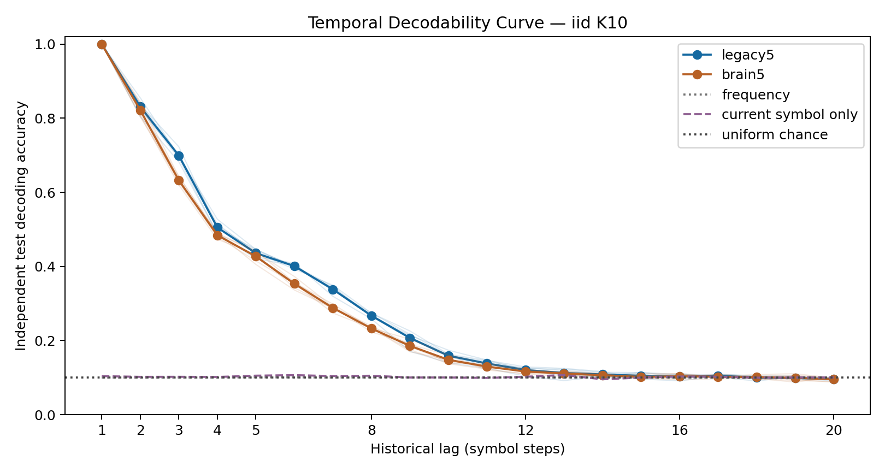
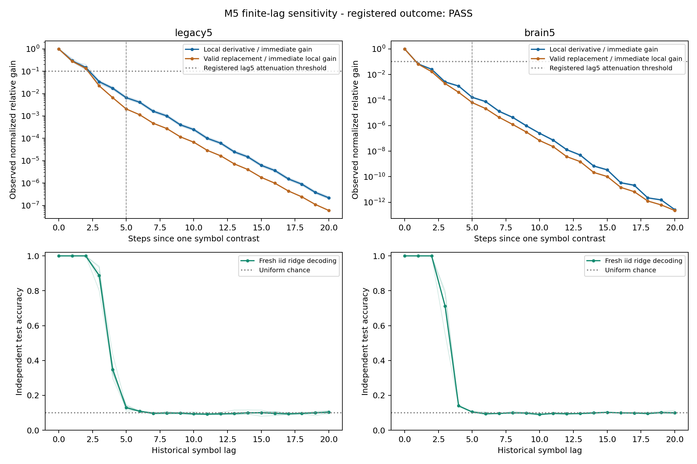
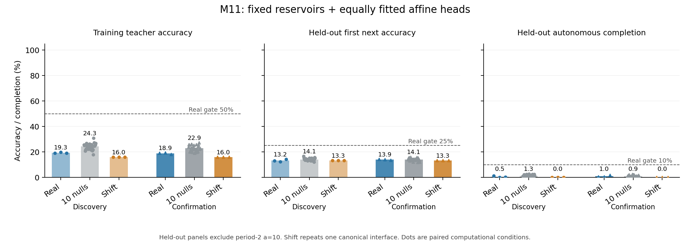

# Historical Input Access and Limits of Rule Continuation in Fixed Fly-Connectome Computational Reservoirs

**Author draft, 2026-10-13.** Scientific evidence cutoff:
`c48e0c43836e640ec1a15b1ac1152f7e3ec4e2a4`; documentary baseline:
`5e78dc5fec885234ae591ba2a56c45c870210ab9`.
Authors, affiliations, correspondence and declarations await project-owner
review. This is a full internal manuscript draft, not a submitted or peer-reviewed
paper. The existing software citation identity is recorded separately in
[CITATION.cff](../CITATION.cff).

[Evidence matrix](research-evidence-matrix.md) ·
[Reproduction index](research-reproduction-index.md) ·
[Literature context and access notes](literature-context.md) ·
[BibTeX](manuscript-references.bib).

[Document/provenance audit](../results/manuscript_draft_v1/audit/checks.json)
checks citation identities, selected numerical anchors, archive preservation and
local links. It does not replace external peer review or execute new model fits.

## Abstract

Connectivity-constrained computational models can retain information about
past inputs, but decoder access alone does not establish fine-wiring advantages,
feedback-specific storage or learned rule continuation. We report a sequence of
repository-preregistered experiments using fixed source-derived fly-connectome
reservoirs and explicitly budgeted external readouts. Independent iid temporal
decoding satisfies the registered short-lag criterion, and frozen lag-2 readouts
track all prescribed past-value replacements in the clean condition. An acyclic,
zero-carry source subset achieves 99.983% partial lag-2 accuracy, demonstrating
bounded delayed-feedforward sufficiency. Exact same-node controls preserving
all-lag dependency-walk support are structurally infeasible, while local response
attenuation is distinct from decoding performance. Material real-wiring advantages
fail in the tested conditional ensembles; a stricter tracking comparison is
ceiling-limited, with real, rewired and engineered reference scores all at 100%.
Frozen tracking also fails one artificial observation-noise condition. An
identifiable held-out affine-coefficient task is feasible, but its matched
fixed-reservoir/affine-head study fails acquisition and continuation requirements:
source training accuracy is 19.35%/18.86% and nonperiod-2 full continuation is
0.51%/1.01% in the two input-map cohorts. Independent implementations reproduce
the registered outputs and decisions. The findings support operational
historical-input access within fixed computational interfaces, while restricting
claims about special wiring, biological learning and mathematical generalization.

**Keywords:** connectome-constrained modelling; reservoir computing; temporal
decoding; structural controls; frozen readouts; reproducibility; rule continuation.

## 1. Introduction

Adult fly connectivity maps and cell annotations provide detailed structural
substrates for computational models [L1](#ref-l1), [L2](#ref-l2). Shiu and
colleagues used a connectivity-based leaky integrate-and-fire model to generate
feeding and grooming predictions that they tested experimentally
[L3](#ref-l3). The present work examines different normalized rate dynamics and
externally supplied symbolic sequences; it does not reproduce that study's
physiological or behavioural validation.

Reservoir computation separates fixed internal dynamics from task-dependent
readouts. Transient circuit states and learned readout extraction are central to
the liquid-state framework [L4](#ref-l4). Echo-state memory and formal
information-processing capacity provide related measurement traditions
[L5](#ref-l5), [L6](#ref-l6). Our temporal decodability curves instead measure
categorical held-out accuracy at specified lags; they are not those formal
capacity measures or estimates of a physiological forgetting timescale.

Connectome-based reservoirs are established prior work. The conn2res framework
supports comparisons across network architectures, dynamics and tasks
[L7](#ref-l7). Costi and colleagues reported overfitting resilience for
fly-connectome-derived chaotic time-series predictors and examined topology/weight
hybrids [L8](#ref-l8). A recent C. elegans preprint also emphasizes that structural
changes and architecture-dependent rescaling can be coupled under spectral-radius
normalization [L9](#ref-l9). These sources motivate explicit normalization and
control accounting; their different tasks and interfaces do not adjudicate our
registered categorical-memory or continuation endpoints.

Several questions therefore require separate tests. Does a model retain
decodable history of an independent input stream? Does the original fine wiring
outperform conditional rewiring controls? Is delayed feedforward propagation
sufficient, or can a contrast isolate anatomical feedback? Does a frozen decoder
follow an actual past-value intervention, including under observation noise?
Finally, can a fitted learner acquire and continue an equation with held-out
coefficients rather than reproduce a seen cycle?

We address these questions through the P1/P2 anchors and M1–M11 programme.
Protocols, finite seeds, budgets, validity gates and stopping rules were committed
before their new recorded outcomes in project Git history. This is repository
preregistration, not an independent external registration service or proof that
every task property was initially unknown. Later questions were informed by
earlier results: notably M2 followed M1, M8 followed control limitations, and M11
followed the known task properties of M10. The contribution is a bounded,
auditable sequence of operational tests and preserved limits, not a claim of
first connectome-based reservoir computation.

## 2. Methods

### 2.1 Source data, graphs and observation interface

The processed FlyWire version-783 connectivity is pinned to upstream commit
`91bdd1e7dcf193f3e7ca5a8933497fcef63b7960`; annotation input is pinned to
`8587524c1748ce5ef2080822a2fc890fc03bf597`. File hashes, source assumptions and
adapter details are retained in the source manifests and
[connectivity adapter](../src/flying/data/connectome.py) and
[role-selection adapter](../src/flying/data/mushroom_body.py). Published structural
and annotation resources provide context [L1](#ref-l1), [L2](#ref-l2); the counts
below are those of our pinned processed pipeline, not a claim that every release
or published simulation uses identical neuron inclusion.

The primary partial circuit, selected with circuit seed 701, has 686 labelled
neurons and 3,309 directed source edges, including 512 input-pool Kenyon cells
(KCs) and 48 observed mushroom-body output neurons (MBONs). Whole-brain secondary
conditions have 138,639 processed neurons and 2,700,513 retained threshold-5
edges. Autapses are excluded. Matrices use postsynaptic rows and presynaptic
columns; signed weights adopt the upstream excitatory/inhibitory column as a
model assumption. Role labels and such signs do not supply cell-specific
physiological calibration. M11 is partial-only.

Each symbol stimulates 51 distinct KCs in the same 512-cell pool at amplitude
0.5. The symbol-specific categorical patterns are drawn from registered seeds
and shared across paired source/null conditions. K=10 applies to historical
decoding and tracking; M10/M11 use K=11. The learner receives categorical identity
through the encoder, not equation coefficients, a rule identifier, or a numeric
magnitude/arithmetic-operator feature. Observations are the same 48 source MBON
coordinates unless the protocol declares an engineered reference.

For raw matrix A, incoming-L1 normalization gives

$$
 W_{ij}=\frac{0.9 A_{ij}}{\sum_k |A_{ik}|},
$$

with a zero row remaining zero. P2 normalizes each raw graph by this same rule,
allowing graph-dependent factors. M8's stricter bank preserves incoming raw
weight multisets and therefore preserves those factors and current coefficients.
Detailed IDs, thresholds, graph hashes and role/weight constraints are specified
in the [canonical protocols](research-evidence-matrix.md).

### 2.2 Rate dynamics, state carry and delayed transmission

Let x(t−1) be the previous full state, p(s_t) the fixed input pattern, b=0.6 the
drive coefficient, c either 0.4 or 0 the direct-carry coefficient, and h either
1 or 0 the previous-state synaptic switch. A preliminary update is

$$
 v(t)=c x(t-1)+b\tanh\!\left(hW x(t-1)+p(s_t)\right).
$$

The computational schedule then recomputes MBONs using current-step KC values:
q_j(t)=v_j(t) for a KC, and q_j(t)=h x_j(t−1) otherwise. For an MBON i,

$$
 x_i(t)=c x_i(t-1)+b\tanh\!\left(\sum_j W_{ij}q_j(t)+p_i(s_t)\right),
$$

while other coordinates retain v(t). Every neuron integrates once; the MBON
recomputation is a declared update schedule, not measured biological timing.
Turning off carry keeps b=0.6 rather than replacing it with one. Turning off
previous-state synaptic drive retains the same-step KC→MBON transmission; in a
carry-only arm that path can still transmit KC carry history. Thus these
interventions are not a pure isolated-neuron versus feedback-cycle comparison.
The equations follow the archived [factor dynamics](../scripts/temporal_mechanism.py)
and [scheduled reservoir](../src/flying/brain/timed_reservoir.py).

M1/M2 compare full, carry-only, synaptic-only and instantaneous arms. M3 and
later source tracking/sensitivity studies use zero direct carry with the
specified synaptic-history condition. Histories start from zero independently
for each iid training/test stream. M11 resets before every episode. Recurrent
weights and encoders are never trained in the studies synthesized here.

### 2.3 External learning and temporal endpoints

For observed features φ, the decoder estimates the training mean μ and
coordinate SD σ, floored at 10⁻⁵. With standardized training matrix Z and
one-hot targets Y, α=1 ridge fitting uses

$$
 B=(Z^\top Z+\alpha I)^{-1}Z^\top(Y-\bar Y),\qquad
 f(\phi)=((\phi-\mu)/\sigma)B+\bar Y.
$$

This is the implemented centered-target affine fit with an unregularized
intercept; scores are not asserted to be calibrated probabilities. A d=48,
K-class head has (d+1)K nominal affine scalars: 490 for K10 and 539 for K11.
Training-derived scaler moments are counted separately and may be shared across
lag heads within a case. The [decoder implementation](../src/flying/models/ridge.py)
and recorded revisions specify the numerical fit. Independent validation uses
an augmented least-squares/SVD formulation. M11's lowest-label selection among
scores within absolute 10⁻¹⁰ of the maximum was declared prospectively; this
policy is not retroactively imposed on older studies.

Historical decoding predicts s_{t−l} from the state after actual input s_t.
Uniform iid K10 streams use warmup 200, 4,000 training and 2,000 test rows;
lag0 current sanity is separate from historical lags1–20. P1 requires every
partial block/lag1–5 cell to exceed max(chance, trained-frequency and trained
current-symbol-only prediction) by at least 10 percentage points (pp). Recurrent
weights remain fixed while only the external readout is fitted.

Teacher-forced next-symbol prediction instead supplies actual past symbols and
targets s_{t+1}. Autonomous continuation supplies a prefix once and thereafter
feeds only the learner's own generated symbols. Exact prefix length ends at
the first error; completion requires the entire declared horizon. Neither
teacher accuracy nor accessibility of past inputs substitutes for completion.
Our accuracy curves are not converted to Jaeger-style or Dambre-style capacity
quantities [L5](#ref-l5), [L6](#ref-l6).

### 2.4 Structural controls and mechanism-specific validity

P2 uses all 20 partial and 10 whole conditional nulls, pairing the registered
input/data blocks and the same readout budget. Its score averages
(accuracy−0.1)/0.9 over lags1–20. It requires real wiring strictly above every
null and a mean adjusted gap of at least 0.03, equivalent to 2.7pp raw accuracy.
Degree/role and outgoing signed raw-weight constraints do not preserve every
incoming strength or normalized current pathway.

M3 orders KCs first, other roles next and MBONs last, sorting numeric root IDs
within tiers, then retains only rank-increasing edges after normalization.
No rescaling follows masking. The entire current KC→MBON block stays exact;
the graph is acyclic but degree, mass and delayed paths change. A positive DAG
decoding result tests sufficiency, not a unique cycle contribution. M4 separately
asks whether exact same-node degree/role/current-block and all-lag structural
walk support can be retained in an acyclic control. Its witnesses concern
structural walks with scheduled delays, not their signed functional magnitude.

M8 preserves both incoming and outgoing signed raw-weight multisets, degrees,
roles, normalization factors and all current KC→MBON coefficients in ten partial
and three whole controls. Fixed finite swaps and constrained proposal pools do
not constitute uniform fully mixed sampling of all allowable wirings. Normalized
outgoing multisets and delayed path organization are not all constrained. Its
separate engineered current/lag-2 reference inherits an analytical source front
end and has different dynamics. M9 fits graph-specific heads, freezes them, and
tests the complete matched bank; the engineered reference is separate from its
primary real/null material gate.

### 2.5 Functional sensitivity and frozen intervention tracking

M5 selects 32 fixed test anchors per case and extends a categorical input code
as p_s+η(p_{(s+1) mod 10}−p_s), holding the full pre-state and future inputs
constant. The derivative at η=0 is sensitivity of a synthetic continuous encoder
extension; η=1 is a valid symbol substitution. Complex-step and centered
finite-difference checks validate the numerical response. The registered
attenuation endpoint requires lag5 relative RMS observed derivative gain at most
0.10 in every primary block, subject to an immediate-gain eligibility floor.
Exact saved-float square ratios adjudicate that rule. This is not a percentage
of categorical memory lost.

M6 reuses the exact M5 lag2 head/scaler, with zero new learned parameters. At
64 fixed unconditioned anchors per case, only the past symbol changes from s
to r=(s+1) mod 10; the prefix and two future inputs match. At lag2 the joint
score requires both the original prediction to equal s and the replacement
prediction to equal r. Every anchor counts. Each primary block must achieve
at least 58/64 joint correct for the registered 90% rule. Unchanged predictors
cannot be correct for both distinct targets; their joint zero is a logical
property rather than a 10% joint-chance baseline.

M7 applies one registered artificial observation-noise condition:
ε=0.10 σ_old Z, using the frozen M5 coordinate scales. The paired worlds share
the same standardized draws in canonical root-ID order. Noise affects only the
64 endpoint observations, with no clipping, refitting or state/feedback write-back.
It is not physiological calibration, a dose-response curve or a noisy
autonomous-recall study.

### 2.6 Held-out affine rules and matched learner budgets

M10 defines x_{t+1}=(a x_t+b) mod 11. All b=0..10 are used. Training multipliers
a=2..6 use nonfixed starts x_0=p+y, where p=b/(1−a) mod 11 and y=1..5;
seen-rule instance tests use y=6..10. Held-out multipliers a=7..10 use all
y=1..10. The resulting 275/275/440 episodes each contain a three-symbol prefix
and eight continuation targets. Rule metadata is scorer-only. Training and
coefficient tests share no initial/teacher three-symbol window or directed-cycle
template up to rotation; seen-rule instance tests intentionally share cycles.

Frequency/suffix lookup tables fit the same 2,200 within-episode transitions
per family. The supplied-form oracle knows the modulus and affine family and
infers its rule from an identifiable prefix; it fits zero model parameters and
is privileged. Iid and shuffled families retain the registered split sizes and
seeds. Unidentifiable negative-family prefixes are kept. The oracle's known
algebraic ability is not a new neural discovery.

M11 compares the real partial circuit, all ten M8 partial nulls and a canonical
three-slot one-hot shift reference. The shift has 33 active coordinates, padded
to the same 686 scalar slots and 48 observed coordinates. Its representation,
input amplitude and dynamics differ from the source circuit; matched nominal
budgets do not mean matched biological front ends or equal effective rank.
All models use a 539-scalar affine head, α1 and 2,200 training rows, then freeze
before evaluation. Six fresh categorical input maps split into three discovery
and three confirmation maps. Affine/iid/shuffled families yield 216 official
fits; the shift's six copies per family are repeated canonical references.

Because a=10 gives period-2 sequences solvable by fixed lag2 copying, M11
prospectively excludes it from the primary, which uses all 330 a=7–9 episodes.
All 440 coefficients and per-rule scores remain reported. In each cohort,
primary support requires source training teacher accuracy ≥50%, first-next
accuracy ≥25%, full continuation ≥10%, at least 5% completion for each of
a=7/8/9, and a source−shift completion gap ≥5pp. Both cohorts must pass all
gates. Secondary fine-wiring support also requires the primary plus strict
superiority over every null and a ≥5pp source−null-mean gap in both cohorts.
Low acquisition is a scientific failure of the learner budget, not a reason to
filter poorly performing heads or declare the assay invalid.

### 2.7 Verification, pairing units and reporting

Protocols specify finite seeds, controls, learning, validity and resource limits.
All raw outcomes, technical interruptions and repairs remain archived.
Independent implementations reconstruct inputs, graph assumptions and dynamics,
refit readouts where appropriate and compare predictions/counts/exact decisions.
Numerical agreement tolerances do not enlarge scientific thresholds. Producer
and successful-verifier revisions are separately pinned in the
[reproduction index](research-reproduction-index.md).

Computational blocks are not animals. Whole analyses frequently reuse the first
three partial input blocks; anchors share streams/heads; affine episodes share
finite rules/cycles; M11 repeats the same task arrays across input maps and
repeats its shift interface. We report raw counts and paired computational
descriptions, not pooled biological replication or a cross-study success rate.
The current manuscript performs literature/context and document checks only;
historical independent validations remain evidence from their recorded runs.

## 3. Results

### 3.1 Independent history access and conditional wiring comparisons

P1 satisfies every registered partial lag/block cell. Partial mean accuracy is
99.96%, 83.11%, 69.93%, 50.53% and 43.60% at lags1–5; it approaches the
historical baselines at longer lags. Lag0 is 100% together with its current-only
baseline and therefore supplies current sanity rather than historical evidence.
The whole curve is secondary and does not establish general whole-brain
superiority. All 252 lag heads and 24 complete-state train/test trace digests
were independently checked. [P1 records](temporal-memory-curve-results.md)

**Figure 1.** Historical accuracy under the registered categorical iid task.
The displayed curve is the archived original; lag0 sanity and long-lag weakness
must be read with the registered short-lag gate. Computational steps are not
physiological time. No new plotting or rescoring was performed for this draft.

P2 fails both material wiring gates. Partial real/raw mean accuracy is 29.664%
versus 31.949% across nulls, a −2.285pp gap, with real below every partial null.
Whole real exceeds every whole null, but its +0.985pp raw gap misses the 2.7pp
requirement. A high finite rank or standardized effect does not replace the
prespecified absolute magnitude. Every conditional graph and lag is retained.
[P2 records](temporal-null-ensemble-results.md)

### 3.2 Carry/history interventions, acyclic sufficiency and strict obstruction

M1's carry-only ongoing current accuracy misses 90% in every relevant block,
while the other arms have 100% current decoding. Its registered conditional
mechanism endpoint is consequently **assay-invalid**, with the primary flag
remaining null. Positive descriptive full−carry contrasts are not eligible
PASS or FAIL tests of that mechanism. The independent replay completed after
the recorded memory repair. [M1 records](temporal-mechanism-results.md)

M2's narrower fresh-stream conjunction passes. Partial carry-only versus
instantaneous gives +6.5617pp mean raw historical accuracy over lags1–5 and
−15.0250pp current accuracy, with all six paired directions as registered.
Other arms preserve high current and history access. The result is a specific
interface/intervention tradeoff, not a universal resource law or repair of M1.
[M2 records](temporal-tradeoff-results.md)

M3's zero-carry DAG satisfies its sufficiency criterion: partial lag2 correctness
is 11,998/12,000 (99.9833%) and whole secondary is 6,000/6,000. Analytical finite
dependency certificates and state replays agree. The partial DAG retains 2,500
of 3,309 edges, including the current block, and has scheduled dependency bound
11; the whole DAG retains 1,353,524 edges with bound 153. These source-derived
acyclic pathways suffice for the tested lag2 interface, but the mask changes
more than feedback cycles. [M3 records](temporal-cycles-results.md)

M4 demonstrates strict design infeasibility. Partial labelled degree/role totals
force reciprocal connections; its APL incident count is 1,140 against a maximum
682 for a DAG over the 683 nonisolated source nodes. Separately, all 90 registered
symbol cells have a source-to-cycle-to-observation witness whose repeated
positive-delay traversal exceeds the universal same-node DAG bound. Whole
degree-only local tests remain UNRESOLVED, while exact all-lag support matching
is infeasible in both levels. This is a structural obstruction, with no neural
fit or functional cycle-performance comparison. [M4 records](cycle-attribution-feasibility-results.md)

### 3.3 Functional influence, clean tracking and a frozen-noise limit

M5 meets its attenuation criterion in every primary block. Partial mean local
lag5/immediate gain is 0.006613, or 0.6613%, while lag2 iid decoding is 100%.
Complete Boolean support at later lags and shrinking functional amplitude
therefore describe different properties. Independent complex-step, finite
difference and valid-substitution checks validate the reported responses.
[M5 records](temporal-functional-sensitivity-results.md)

**Figure 2.** Local derivative gain, valid replacement effects and iid decoding
are retained in the original M5 display. Gain ratios concern selected continuous
code contrasts; they are not fractions of lost memory or categorical capacity.

M6's unchanged M5 lag2 head follows all 384 partial and 192 paired whole
original/replacement transitions. Every fixed anchor counts. Unchanged
frequency/current/instantaneous controls have joint0, as required for identical
predictions against two distinct targets. New learned parameters are zero.
[M6 records](counterfactual-tracking-results.md)

M7's fresh clean counterparts again track every pair, but the registered noisy
joint counts are 255/384 (66.4063%) partial and 109/192 (56.7708%) whole. Every
noisy block fails the integer 90% rule; even 57/64=89.0625% cannot be rounded to
58/64. Independent reconstruction reproduces shared draws and the frozen-head
negative result. No dose search or noise refit followed.
[M7 records](counterfactual-noise-results.md)

### 3.4 Feasible matched controls and a saturated advantage endpoint

M8 constructs all ten partial and three whole matched controls with exact
registered invariants and independent regeneration. Delayed locations change
22.34–23.76% in partial graphs and 85.94–85.99% in whole graphs. The partial
proposal pool spans only 602 of 1,835 delayed edges, so substantial structure
remains shared. Analytical engineered-reference/rank checks pass. The outcome
is **READY**, with zero neural fits; it does not establish performance.
[M8 records](structural-specificity-design-results.md)

M9's 87 actual/null/reference conditions all reach 100% current and lag2
accuracy and all 5,568 joint probe pairs are correct. Independent state/head
reconstruction matches. Current-access validity passes, but all real/null means
tie and the real−null gap is 0pp, so the material 3pp/strict-order hypothesis
fails in both levels. Basic tracking success is not the registered wiring
advantage; ceiling ties do not establish universal equivalence.
[M9 records](structural-tracking-results.md)

### 3.5 Task readiness and acquisition-limited continuation

M10's 990 structured prefixes identify their intended rules, with no held-out
training prefix/window/cycle overlap. The history-3 table completes every
training and seen-rule instance episode, yet none of the coefficient tests.
The supplied-form oracle completes all 440 coefficient episodes. Independent
reconstruction covers all 2,970 family episodes and 63 predictor evaluations;
the task outcome is **READY**. Its producer summary's pending label is preserved,
with final readiness established by the matching successful validation/audit.
[M10 records](rule-transfer-design-results.md)

All 216 M11 fits and independent SVD refits complete. The registered primary
and secondary criteria both fail; technical/task checks pass. The table reports
the exact archived cohort counts, where three input maps repeat the same
330 primary task episodes.

| M11 affine measure | Discovery source | Confirmation source | Required source gate |
| --- | ---: | ---: | ---: |
| Training teacher accuracy | 1277/6600 (19.35%) | 1245/6600 (18.86%) | ≥50% |
| First next, a7–9 | 131/990 (13.23%) | 138/990 (13.94%) | ≥25% |
| All-8 teacher accuracy, a7–9 | 1319/7920 (16.65%) | 1217/7920 (15.37%) | Diagnostic |
| Full autonomous completion, a7–9 | 5/990 (0.51%) | 10/990 (1.01%) | ≥10% |
| Source−shift completion | +0.505pp | +1.010pp | ≥5pp |
| Source−null-mean completion | −0.747pp | +0.141pp | Secondary ≥5pp plus strict order |

Source completion is zero for multipliers7/8 and 5/330 or 10/330 for multiplier9;
none meets the 5% per-multiplier gate. Source is not strictly above every null
in either cohort. Shift primary completion is zero. Fixed lag2 copying solves
all 110 period-2 a10 cases and none of the 330 primary cases; these easy repeats
were excluded prospectively rather than removed after observing performance.
All rules, input maps and iid/shuffled diagnostics remain reported.

**Figure 3.** The full-scale archived plot retains acquisition, first-next and
autonomous completion as separate panels. Null bars include all ten graphs;
shift repeats one canonical interface. Dashed lines represent named absolute
source gates, not the entire conjunction. State replay covers 427,680
teacher/autonomous trajectories, with all predictions/counts and exact decisions
matching. These are execution records, not independent animals or task draws.
[M11 records](rule-transfer-results.md)

Acquisition already fails in the training data. This learner budget therefore
does not support an interpretation of isolated transfer failure following
successful rule mastery. It also supplies no material source-wiring advantage.
The outcome remains a completed scientific **FAIL**, rather than an assay
invalidated or extended until a successful architecture appears.

## 4. Discussion

### 4.1 Historical access is the supported operational claim

Independent-stream decoding and fixed-readout value interventions support
historical-input access within the stated computational interfaces. That finding
fits the reservoir perspective in which readouts can exploit transient states
[L4](#ref-l4), but does not transfer the framework's theoretical guarantees or
biological mechanisms to our particular schedule. Structural paths, response
amplitude, decoder accuracy and generated continuation answer distinct questions.
The separation is especially visible when low relative local gain coexists with
perfect short-lag decoding or a clean tracking result fails a frozen-noise test.

Formal capacity frameworks use specified reconstruction functions and assumptions
[L6](#ref-l6). We neither sum an orthogonal-function capacity decomposition nor
infer Shannon capacity from categorical accuracy, graph size or a prefix score.
Our chosen observation budget also limits inference about information that other
coordinates or alternative decoders might access.

### 4.2 Fine-wiring claims depend on task and matching assumptions

The present failures do not imply that all anatomical wiring is functionally
equivalent. P2's controls couple some structural changes to normalization; M8
preserves a stronger set of properties but samples a finite constrained bank;
M9 has a ceiling. These differences need to accompany each result rather than
be merged into one universal topology conclusion.

Related connectome reservoirs already investigate architecture/task dependence
[L7](#ref-l7). The conn2res fruit-fly comparison uses FlyCircuit and does not
report the null advantage found for other species in that example; it is not
the present neuron-level assay. Costi et al.'s reported overfitting resilience
concerns chaotic prediction with different reservoir selection, normalization,
hybrid controls and readout conditions [L8](#ref-l8). Our categorical gates are
not a contradiction, replication or direct numerical benchmark of that result.

The 2026 normalization study is a preprint about C. elegans and spectral-radius
rescaling [L9](#ref-l9). Its coupled-effects argument is relevant as a warning
against attributing rescaled contrasts solely to topology. Our incoming-L1
scheme and current-path-preserving controls address different conditions, so we
use it for context rather than evidence of our own performance or robustness.

### 4.3 Acyclic sufficiency does not identify anatomical storage

M3 supplies a concrete delayed-feedforward alternative for the bounded lag2
result. M4 shows why one exact ideal matching proposal cannot adjudicate a pure
cycle effect: preserving all structural walk delays conflicts with removing
positive-delay cycles, and partial degree/role totals add an obstruction.
Neither finding excludes approximate matching, alternative interventions or
other functional comparisons. Long structural support is also compatible with
strong attenuation in the actual signed/nonlinear model, as M5 demonstrates.

Thus successful decoding cannot by itself locate a biological storage site or
quantify the contribution of feedback cycles. The present assumptions omit
cell-specific physiological calibration and learning of recurrent connections.
The connectivity-based spiking sensorimotor validation of Shiu et al. is a
distinct achievement with different dynamics and empirical targets
[L3](#ref-l3); it is not validation of this symbolic-memory model.

### 4.4 Continuation failure begins with weak task acquisition

The seen-rule control result in M10 shows why a new initial phase is insufficient
as a generalization test: finite-context lookup can complete those cycles. The
held-out coefficient test is stronger within the same affine family, but its
formula oracle has prior knowledge not given to the learned models. Categorical
input codes and a small fixed-reservoir/affine-head interface are explicit design
choices, not a general theory of learning arithmetic.

M11's low training accuracy limits conclusions about transfer mechanisms.
The selected representation/readout/training budget already struggles with the
supervised task; the study does not identify which alternative feature map,
nonlinear head, recurrent learning rule or data budget would overcome it.
Such alternatives need separate prospective questions and controls, not a
post-outcome search that changes the meaning of this failure. No broad inability
of fly-derived networks, finite-state systems or biological animals follows.

### 4.5 Evidence and review limitations

The programme uses one pinned processed structural resource and restricted
interfaces, finite conditional null banks and shared computational task sets.
It tests no new biological animals and establishes no physiological plasticity.
Nominal parameter equality does not ensure equal effective rank, representation
or anatomical constraints. Positive secondary directions and exact invalidity
types are retained rather than combined into a pooled success rate.

The literature selection is representative and claim-focused, not a systematic
review or priority/novelty certification. Publisher access limitations and the
preprint status of [L9](#ref-l9) are explicit in the literature notes. Seven
journal articles, one original technical report and one preprint contextualize
the draft; we do not import their figures or claim to replicate their code.
Human authorship, declarations, venue-specific formatting and final scientific
review remain before any external submission.

## 5. Conclusion

Fixed source-derived fly-connectome reservoirs support operational short-history
access and bounded clean past-value tracking through trained external readouts.
The programme also establishes delayed-feedforward sufficiency and limits on a
strict cycle-matching design. It does not establish general material fine-wiring
superiority, robust frozen tracking at the tested noise condition, or learned
affine-rule continuation at the registered learner budget. M11 acquisition
failure is integral to that interpretation. Preserving positive, negative,
undefined and feasibility outcomes with their independent checks provides a
concrete basis for future, separately scoped computational studies.

## 6. Data, code, provenance and declarations

The [evidence matrix](research-evidence-matrix.md) links every protocol, actual
learning budget, complete result manifest, successful independent checks and
canonical final audit. The [reproduction index](research-reproduction-index.md)
separates producer/verifier pins, recorded environments, parent archives and
hash-matched ignored caches. Its checks concern static/provenance consistency;
the historical numerical validations were executed at their recorded revisions,
not rerun while writing this manuscript. Fresh replay directories must not
overwrite old evidence.

The documentary synthesis preserves 49,539 prior result Git identities at its
cutoff, with sparse-excluded paths distinguished from materialized byte checks.
It retains incomplete and scientifically-invalid snapshots, including the M4
source mismatch and the synthesis's self-link/newline audit interruptions.
M10's producer pending label remains unchanged while its final READY comes from
successful validation. The manuscript introduces no new model outcome, fitted
parameter, graph selection or retrospective metric change.

The software is released under the repository [MIT license](../LICENSE).
Underlying datasets and literature retain their own attribution/licensing terms;
software licensing does not grant rights over every upstream asset. Only existing
DrosoMem figures are linked here. Source data provenance includes the pinned
processed connectivity and annotation repositories above. No new animal
experiment is reported by this computational programme.

Paper authorship/affiliations, funding, competing-interest and contributor
statements require the project owner's factual input before submission. No
funding source, institutional affiliation, ethics identifier, external peer
review, project DOI or journal submission is fabricated or claimed. Repository
software citation identity does not automatically determine manuscript authorship.

## References

Full titles and transferable bibliography entries are in
[manuscript-references.bib](manuscript-references.bib). Primary access scope,
locators and claim boundaries are in [literature-context.md](literature-context.md).

**L1.** Dorkenwald et al. (2024). *Nature* 634, 124–138.
[Adult FlyWire structural resource](https://doi.org/10.1038/s41586-024-07558-y).

**L2.** Schlegel et al. (2024). *Nature* 634, 139–152.
[Whole-brain annotation resource](https://doi.org/10.1038/s41586-024-07686-5).

**L3.** Shiu et al. (2024). *Nature* 634, 210–219.
[Connectivity-based sensorimotor model](https://doi.org/10.1038/s41586-024-07763-9).

**L4.** Maass, Natschläger and Markram (2002). *Neural Computation* 14, 2531–2560.
[Transient-state computation](https://doi.org/10.1162/089976602760407955).

**L5.** Jaeger (2001). GMD Technical Report 152.
[Original echo-state short-term-memory report](https://www.ai.rug.nl/minds/uploads/STMEchoStatesTechRep.pdf).

**L6.** Dambre, Verstraeten, Schrauwen and Massar (2012). *Scientific Reports* 2, 514.
[Formal reconstruction capacity](https://doi.org/10.1038/srep00514).

**L7.** Suárez et al. (2024). *Nature Communications* 15, 656.
[conn2res framework](https://doi.org/10.1038/s41467-024-44900-4).

**L8.** Costi et al. (2025). *Biomimetics* 10(5), 341.
[Fly-connectome forecasting study](https://doi.org/10.3390/biomimetics10050341).

**L9.** Churchland et al. (2026). arXiv:2609.07355v1, submitted 7 September 2026.
[Normalization/robustness preprint](https://arxiv.org/abs/2609.07355v1).
Submitted to *Neural Networks* according to the primary record; treated here as
a preprint, not a peer-reviewed journal publication.
