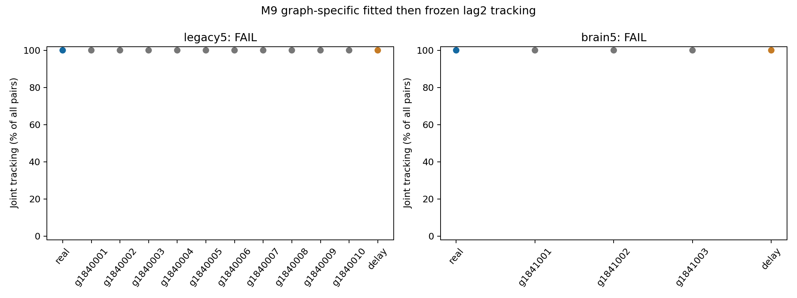

# M9: fitted then frozen structural tracking — results and synthesis

Date: 2026-10-12. **Registered primary FAIL; secondary FAIL.** All87 cases
and independent validation are complete. Current-access validity passes in
both levels; this is a valid negative advantage result, not assay-invalid.
[Protocol](structural-tracking-protocol.md), [prior audit](structural-tracking-prior-audit.md),
[config](../configs/structural_tracking.json).

## 1. What was asked?

After equal-budget graph-specific training followed by frozen held-out test,
does original source-derived delayed wiring track a changed past symbol
materially better than the complete M8 matched rewiring bank? The separate
engineered delay is a reference, not an anatomical null or primary comparator.

Baseline main `b2ef8412832ce64e208287fe063abe8068b5df5c`. Protocol/config commit
`6bb55fb7c534fe4d29ab366bf9a04eec3ac4b81e` precedes new M9 source head/trajectory
outcomes. Main/independent validation source
`e7100ea3066cca4126114a9d963fc97c260771e3`.
New namespace `results/structural_tracking_v1/`; old results remain unchanged.
Earlier near-ceiling real clean results and M8 prototype geometry were known;
this is a prospective new head/stream/null-tracking comparison, not a claim
that all real/reference properties were initially unknown.

Use ALL10 partial and3 whole M8 nulls, original circuit701 and the M8 delay
reference. No new graphs/search/selection. Source/null dynamics: incoming-L1
gain.9, drive.6, zero direct carry, synaptic history, mbon_after_kc. Same512
source KC pool/51 active per K10 symbol at amplitude.5,48 MBON observations.
Current coefficients, degrees/roles and both signed raw weight multisets stay
matched. Normalized outgoing multisets/delayed paths are not constrained.

Each graph fits alpha1 affine heads for lag0/lag2 on4000 training rows with
train-only mean/SD floor1e-5, then freezes them before test. Per lag490 affine
parameters, case980, all conditions equal. Main174 lag heads contain85260
nominal fitted affine scalars; additionally8352 train-derived scaler moments
(96 per case, shared by both heads). Recurrent/encoder/template learning0.
These are computational readout fits, not biological synaptic learning.

Reuse input maps1810001–1810006, blocks1900001–1900006; fresh independent train
1910001–1910006/test1920001–1920006. Uniform iid K10, reset streams independently,
warmup200, test2000. Whole firstthree are paired counterparts, not additional
independent input replicates. Every graph/block uses64 fixed unconditioned
anchors. Change only input s at a to r=(s+1)%10, preserve the full prefix and
both future inputs, evaluate the same frozen lag2 head at a+2.

Graph score is the equal-block mean of joint tracking, with both original==s
and replacement==r required. First require EVERY real/null lag0 current cell
>=90%; otherwise the comparative endpoint is assay-invalid, with all raw
scores retained. If valid, real must be strictly above EVERY null and
real−null mean>=3 RAW percentage points. Exact integer/Fraction arithmetic
sets the gate. Delay's current/90%-joint benchmark is separate and cannot
rescue the real/null endpoint. No clean-success filtering or criterion change.

## 2. What was confirmed?

All models meet the current-access rule, and every64 paired trial is correct.
Original and changed-value predictions follow their respective actual inputs;
all prediction pairs change. The observed finite scores are at ceiling.

| Analysis | Original real joint | Each null joint | Engineered delay joint | Real−null mean | Registered advantage |
| --- | ---: | ---: | ---: | ---: | --- |
| Partial,6 blocks/10 nulls | 384/384 (100%) | 384/384 (100%) | 384/384 (100%) | 0pp | **FAIL** |
| Whole secondary,3 blocks/3 nulls | 192/192 (100%) | 192/192 (100%) | 192/192 (100%) | 0pp | **FAIL** |

Partial nulls collectively have3840/3840 pairs; secondary nulls576/576.
All87 cases have original/replacement/joint64/64; total5568 paired probes.
Do not pool paired levels or treat repeated graph/stream probes as animal
replicates. [Every trial](../results/structural_tracking_v1/main/raw-trials.csv),
[every case](../results/structural_tracking_v1/main/block-scores.csv),
[graph scores](../results/structural_tracking_v1/main/graph-scores.csv),
[exact summary](../results/structural_tracking_v1/main/summary.json).

Lag0 and lag2 full-stream accuracy are100% in EVERY case:174000/174000 predictions
per lag, across87 paired-condition cases, not174000 independent inputs. For
each lag, partial real/null/delay counts are12000/120000/12000; whole counts
6000/18000/6000. Current access is100% in each original-history case, not merely
a zero-history coefficient/rank certificate. Frequency/current-only lag2
baselines remain training-derived and are reported per case with uniform10%
single-arm chance. [Stream metrics](../results/structural_tracking_v1/main/stream-metrics.csv).

| Finite score description | Partial | Whole secondary |
| --- | ---: | ---: |
| Null mean/median/min/max | 1/1/1/1 | 1/1/1/1 |
| Null sample SD | 0 | 0 |
| Real strictly above all nulls | false, all ties | false, all ties |
| Real empirical percentile, half weight for ties | 50 | 50 |
| Standardized effect | undefined, SD0 | undefined, SD0 |
| Real−null paired block mean/median/SD | 0/0/0 | 0/0/0 |
| Descriptive bootstrap interval,1930001/10000 draws | [0,0] | [0,0] |
| Real−delay difference and paired interval | 0pp /[0,0] | 0pp /[0,0] |
| Separate90% real/delay tracking criteria | PASS/PASS | PASS/PASS |

Tied50th percentile is the predefined finite ranking convention, not a
biological p-value. Zero observed dispersion/intervals do not prove equivalence
or absence of all structural effects.



Blue is real, gray nulls, orange the different engineered reference. Each dot
averages all64 anchors per fixed block. Plot FAIL labels refer to the material
wiring-advantage gate, not basic decoding/tracking failure. This is one lag/
one cyclic substitution rule, not a temporal-capacity curve or autonomous recall.

Unchanged frequency/current-input predictors and history-off reference have
joint0 mathematically because s!=r. Instantaneous reference full final states,
scores and predictions are equal across worlds, retaining the SAME case head
off its training distribution. This is not a10% joint-chance estimate, and
its marginal accuracy is not a physiological validity test. The affine
replacement-minus-original contrast-margin change matches projection of the
observed-state change through the same frozen scaler/head. Full prefix/future
equality and original-window equality with baseline are verified exactly.

## 3. What failed or remains unresolved?

The **material real-wiring advantage hypothesis failed**: real is tied with
all nulls and the0pp gap misses3pp in both analyses. Access/tracking90% passing
does not substitute for that hypothesis. No lag/noise/alphabet/seed/null-count/
threshold/head tuning was performed to create separation after the ceiling.

This task is saturated, limiting sensitivity to structural differences. M8's
partial pool permits only602 of1835 delayed edges to be proposed for swaps;
many edges and the entire current pathway are shared. The finite conditioned
bank is not uniform or fully mixed all-wiring sampling. Whole's3 nulls are a
small secondary set. Neither ties nor perfect accuracy establish universal
wiring equivalence, a biological null population, or a pure feedback-cycle effect.

The engineered reference uses608 active slots padded to original N, source
instantaneous templates/current24/past24 and unit shifts. It inherits a source
front end, with different anatomy/roles/weights/dynamics. Its success is
empirical generic-delay sufficiency conditional on that interface and budget,
not proof that no connectome-derived property matters. The exact templates
are fixed M8 model data; their source formula independently agrees before
official trajectory replay uses their authenticated bytes.

No M9 safeguards, execution or independent verification failed. The registry
is [empty](../results/structural_tracking_v1/known-incomplete-attempts.json).
Smoke verification emitted a pandas FutureWarning for CSV NaN versus JSON None
in the intentionally null tracking diagnostic; current pinned-environment
comparison passed and no evidence or criterion was modified. Smoke repeats
the first fixed streams as short prefixes/first-null cases and is excluded
from main statistics; it is not an independent confirmation cohort.
Old technical failures and negative scientific results stay unchanged.

## 4. What can now be said about DrosoMem?

Source-derived fixed reservoirs retain decodable historical inputs and fitted
then frozen heads causally follow actual past-value substitutions on independent
iid test inputs. In this stronger current/weight/degree/role-matched conditional
comparison, original delayed wiring has **no detected material lag2 advantage**.
Matched rewiring and the explicit simpler delay also track all probes under
the fixed data/head budget. A unique benefit of fine source wiring is unconfirmed
at this saturated endpoint; broader tasks/structures remain unresolved.

P2 and M7 FAIL, M1 assay-invalid, M4 strict INFEASIBLE, M8 READY and original
v1/P1 evidence remain as sealed. New clean heads do not rescind M7's frozen-head
noise failure. No storage site, physiological plasticity/learning, living-fly
pi memory, whole-brain superiority or formal Shannon/reservoir capacity is
established. Recurrent weights never learned. P3 was not performed.

This bounded M9 comparison is closed; no execution/verification remains.
The next roadmap priority is **mathematical-sequence rule transfer**: first
design held-out sequence instances/rule parameters and trivial-history/predictor
controls that separate recalling a trained string from predicting or applying
an unseen rule. Working M10 is only a proposal, unregistered/unexecuted. No
automatic stricter lag/noise rerun or hidden biological plasticity follows M9.

## Independent validation and reproducibility

[Main independent checks](../results/structural_tracking_v1/main_validation/checks.json)
authenticate/recheck all13 parent structures from independent pinned source
loaders and rebuild graph/encoder/delay layout. All174 train/test complete-state
hashes,5568 pre-state digests and22272 four-world windows plus22272 final digest
entries match. Counts are replay records, not distinct animals; equal reference
endpoints and original/baseline windows can repeat states.

All174 lag heads are refit by augmented SVD, using only independently replayed
training states/labels. Mean/scales/coefficients/scores agree within the fixed
1e-9 checks; ALL integer predictions, labels, controls and primary/validity
decisions match exactly. All five CSV tables and every descriptive summary
are independently recalculated. No main M9 model/trajectory/scorer/fitter/
summary algorithm is imported by the verifier. Main learns87 dual-head banks;
the174 lag heads are not174 independent biological models. There are78 source
cases/156 source trajectories and9 engineered cases/18 trajectories.

| Stage | Attempt wall seconds | Resource peak |
| --- | ---: | ---: |
| Baseline seal | 29.406 | Per-process OS76906496 bytes |
| Eleven safeguards | 31.813 | Per-process OS122712064 bytes |
| Smoke,6 cases/12 heads/384 pairs | 66.070 | Sampled aggregate886972416 bytes |
| Independent smoke | 160.868 | Sampled aggregate1016975360 bytes |
| Main,87 cases | 652.634 | Sampled aggregate1069854720 bytes |
| Independent main | 756.003 | Sampled aggregate1130151936 bytes |

Four workers/one numeric thread, fixed7200s/4GiB per main/verification stage.
50ms tree sampling sums RSS and may double-count shared pages. Initial source
capture before main/verifier attempts is outside reported attempt wall time;
individual OS lifetime peaks/environment are also archived. Compact48-coordinate
windows plus full-state hashes avoid storing all full neural trajectories.

[Baseline audit](../results/structural_tracking_v1/baseline_audit/audit.json)
protects45525 prior result identities/46203 baseline paths, with all materialized
files authenticated.39608 sparse-excluded results are protected by Git identity,
not claimed freshly replayed. Old source/data/config/protocol/tests/failures
stay unchanged; only the four overview documents update dated handoffs.
[Final artifact audit](../results/structural_tracking_v1/final_audit/audit.json)
checks manifest coverage/checksums, recorded Git sources, finite case arrays,
all CSVs, labels/predictions, exact scalar/validity rules, documents and history.

Main manifest SHA256:
`5f720f4b4e456810ac7b866e37f9fcb8b59f518d29aec962fd322132f3d2777f`.
Parent M8 main SHA256:
`528d420d16b55ccc99d8c180fdd07886cab1235d14b6ce1043bb381f2a0780eb`.

Use the captured Python/package environment, pinned partial/raw/whole cache
and complete hash-matched M8 bank. From repo root, with unchanged source during
each stage and fresh output directories:

```powershell
$env:PYTHONPATH='src;scripts'
$env:OPENBLAS_NUM_THREADS='1'
$env:OMP_NUM_THREADS='1'
$env:MKL_NUM_THREADS='1'
python scripts/run_structural_tracking_guards.py --out outputs/m9_replay_guards
python scripts/structural_tracking.py --out outputs/m9_replay_smoke --smoke
python scripts/verify_structural_tracking.py --result outputs/m9_replay_smoke --out outputs/m9_replay_smoke_validation
python scripts/structural_tracking.py --out outputs/m9_replay_main
python scripts/verify_structural_tracking.py --result outputs/m9_replay_main --out outputs/m9_replay_main_validation
```

## 비전공자를 위한 한국어 요약

실제 초파리 연결망을 바탕으로 한 모델이 다른 연결 배치보다 과거
숫자를 더 잘 읽는지 비교했습니다. 숫자가 들어오는 길과 연결 수·
가중치 조건을 맞추고, 각 모델의 출력기만 같은 예산으로 학습했습니다.

모든 모델이 두 단계 전 숫자와 그 숫자를 바꾼 경우까지100% 맞췄습니다.
단순히 숫자의 흔적을 두 칸 늦춰 전달하는 장치도 똑같이 맞췄습니다.
따라서 실제 배선이3%p 이상 더 좋아야 한다는 기준은 실패했습니다.
쉬운 과제의 만점 결과를 실제 배선의 특별한 기억 능력으로 해석하지
않고, 과제를 바꿔 성공시키지도 않았습니다.

현재까지는 이 계산 모델들에 과거 입력의 흔적이 남는다고 말할 수
있습니다. 실제 초파리의 학습·기억이나 모든 생물학적 배선의 중요성을
판정한 연구는 아닙니다. 다음에는 수열을 그대로 외우는 것과 새로운
수열 규칙을 적용하는 것을 구분할 과제부터 설계합니다.
